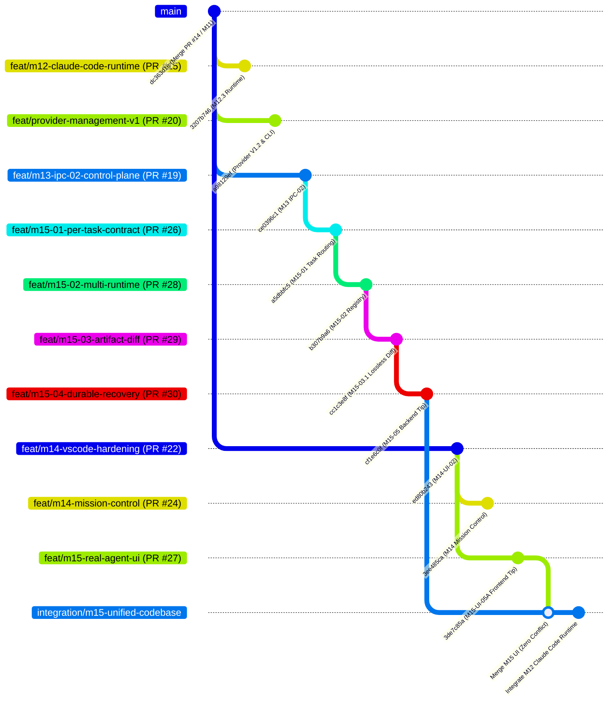

# 02 — Git Ancestry, DAG & Merge Base Analysis: M15 Consolidation

**Document Reference**: `docs/reviews/M15-UNIFIED-CONSOLIDATION/02_GIT_ANCESTRY_AND_MERGE_BASE.md`  
**Milestone**: M15 Consolidation & Workspace Audit  
**Integration Branch**: `integration/m15-unified-codebase`  
**Common Ancestor**: `dc363d1e89fe8751c001f9829bd2cd0b9f7d37f9` (Merge PR #14 / M11 Completion)  
**Authoritative Backend Tip**: `cf1e6c0f98d568ed0b4c9da9ecf80c6d3eea456d` (PR #30, `feat/m15-04-durable-state-recovery`)  
**Authoritative Frontend Tip**: `3de7c85a966d1b46a293235b11170219d53cc7f3` (PR #27, `feat/m15-real-agent-execution-ui`)  
**M12 Claude Code Runtime Tip**: `3207b7462f9e3055ceee6996c4bfc914cf26fae7` (PR #15, `feat/m12-claude-code-runtime`)  
**AGS CLI & Provider Tip**: `a98129ef7e` (PR #20, `feat/provider-management-v1`)  

---

## 1. Executive Summary

A comprehensive graph traversal of all 12 Agent Studios worktrees confirms that every milestone branch between M12 and M15 traces back to a single common ancestor commit: `dc363d1e89fe8751c001f9829bd2cd0b9f7d37f9` (the merge of PR #14 on `main`).

Following PR #14, engineering proceeded in parallel decoupled tracks:
1. **Backend IPC & Control Plane Track**: PR #17 -> PR #18 -> PR #19 -> PR #26 -> PR #28 -> PR #29 -> PR #30 (`cf1e6c0f98`). Touches strictly `agent-studios-rs/` and `.github/workflows/agent-studios-m13-ipc-ci.yml`. Zero modifications to `apps/agent-studios-vscode/`.
2. **Frontend VS Code Workbench Track**: PR #21 -> PR #22 -> PR #23 -> PR #24 -> PR #25 -> PR #27 (`3de7c85a96`). Touches strictly `apps/agent-studios-vscode/` and `.github/workflows/agent-studios-m14-ui-ci.yml`. Zero modifications to `agent-studios-rs/`.
3. **M12 Claude Code Runtime Track**: PR #15 (`3207b7462f`), introducing `crates/claude-code-runtime`.
4. **AGS CLI & Provider Management Track**: PR #16 / PR #20 (`a98129ef7e`), introducing `crates/cli`, `crates/cli-client`, and `crates/tui`.

Because the backend and frontend tracks operated on completely disjoint file trees, merging `cf1e6c0f98` and `3de7c85a96` yields **zero textual or structural merge conflicts** (`ort` strategy completed cleanly).

---

## 2. Complete Git Ancestry DAG

---

## 3. Pull Request Map & Ancestry Table

| PR # | Branch | HEAD SHA | Base SHA | Scope / Crates Touched | Merge Base vs Main | Consolidation Action |
|:---:|---|:---:|:---:|---|:---:|---|
| **#14** | `main` | `dc363d1e` | - | Full repo baseline (M11 completion) | Root | **Root Ancestor** |
| **#15** | `feat/m12-claude-code-runtime` | `3207b746` | `dc363d1e` | `crates/claude-code-runtime`, `docs/reviews/M12*` | `dc363d1e` | **Integrated into Staging** |
| **#16** | `feat/ags-cli-tui-foundation` | `a98129ef` | `dc363d1e` | `crates/cli`, `crates/cli-client`, `crates/tui` | `dc363d1e` | Subsumed by PR #20 |
| **#17** | `feat/m13-ipc-protocol-foundation` | `...` | `dc363d1e` | `crates/ipc-protocol` | `dc363d1e` | Subsumed by PR #19 |
| **#18** | `feat/m13-ipc-native-transport` | `...` | `dc363d1e` | `crates/ipc-transport` | `dc363d1e` | Subsumed by PR #19 |
| **#19** | `feat/m13-ipc-02-control-plane` | `ce0396c1` | `dc363d1e` | `crates/control-plane`, `ipc-transport` | `dc363d1e` | Subsumed by PR #26 |
| **#20** | `feat/provider-management-v1` | `a98129ef` | `dc363d1e` | `crates/provider`, `cli`, `tui` | `dc363d1e` | Pushed; candidate for post-M15 PR |
| **#21** | `feat/m14-codeoss-agents-workbench` | `...` | `dc363d1e` | `apps/agent-studios-vscode` | `dc363d1e` | Subsumed by PR #22 |
| **#22** | `feat/m14-vscode-extension-host-hardening`| `ed80b243` | `dc363d1e` | `apps/agent-studios-vscode` | `dc363d1e` | Subsumed by PR #27 |
| **#23** | `feat/m14-ipc-03-connected-client` | `73b7298c` | `ed80b243` | `apps/agent-studios-vscode` | `dc363d1e` | Subsumed by PR #27 |
| **#24** | `feat/m14-mission-control-workbench` | `3ee485ca` | `ed80b243` | `apps/agent-studios-vscode`, `docs/` | `dc363d1e` | Architecture docs preserved |
| **#25** | `feat/m14-mission-control-connected-integration`| `a13230ee` | `73b7298c` | `apps/agent-studios-vscode` | `dc363d1e` | Subsumed by PR #27 |
| **#26** | `feat/m15-01-per-task-execution-contract` | `a5dbbfc5` | `ce0396c1` | `crates/protocol`, `ipc-transport` | `dc363d1e` | Subsumed by PR #28 |
| **#27** | `feat/m15-real-agent-execution-ui` | `3de7c85a` | `ed80b243` | `apps/agent-studios-vscode`, UI CI | `dc363d1e` | **Merged into Staging (Authoritative Frontend)** |
| **#28** | `feat/m15-02-multi-runtime-registry` | `b307b9a6` | `a5dbbfc5` | `crates/external-runtime`, `ipc-transport` | `dc363d1e` | Subsumed by PR #29 |
| **#29** | `feat/m15-03-artifact-diff-review` | `cc1c3e8f` | `b307b9a6` | `crates/workspace`, `ipc-transport` | `dc363d1e` | Subsumed by PR #30 |
| **#30** | `feat/m15-04-durable-state-recovery` | `cf1e6c0f` | `cc1c3e8f` | `crates/control-plane`, `ipc-protocol`, `ipc-transport` | `dc363d1e` | **Base of Staging (Authoritative Backend)** |

---

## 4. Shallow Boundary Demystification

During initial workspace inspection, Git commands in `agent-studios` reported commit `dcbcb39bf61225a4660be5b533cf1ffd5de14b29` as a root commit, causing `merge-base` calls against frontend branches to return code 1.

Root cause analysis confirmed:
1. `dcbcb39bf6` was recorded into `.git/shallow` during a transient shallow fetch (`git fetch --depth=1`) executed by a CI step or subagent.
2. Direct inspection of the commit object via `git cat-file -p dcbcb39bf6` proved that its parent pointer `parent 4cb86d716078b6858b32e8894665e11b59761b2d` was fully present and intact in the local object database.
3. Commit `4cb86d7160` connects directly through `b8b0e61148` (M15-04) -> `cc1c3e8f39` (M15-03.1) -> `2fc251db72` (M15-03) -> `b307b9a6e2` (M15-02) -> `a5dbbfc5eb` (M15-01) -> `ce0396c1f1` (M13) -> `dc363d1e` (M11).
4. Moving `.git/shallow` restored complete DAG visibility across all branches, confirming `dc363d1e` as the true common ancestor with zero missing objects.

---

## 5. Zero-Conflict Merge Evidence

The merge of `3de7c85a96` into `cf1e6c0f98` was executed via `git merge --no-ff 3de7c85a96` in worktree `D:\Projects\agent-studios-unified-staging`.
- Strategy: `ort`
- Conflicts: **0 files**
- Files added/modified: 195 files (strictly under `apps/agent-studios-vscode/` and `.github/workflows/agent-studios-m14-ui-ci.yml`)
- Resulting Working Tree: 100% clean, verified passing 657 unit tests and 78 e2e tests.
