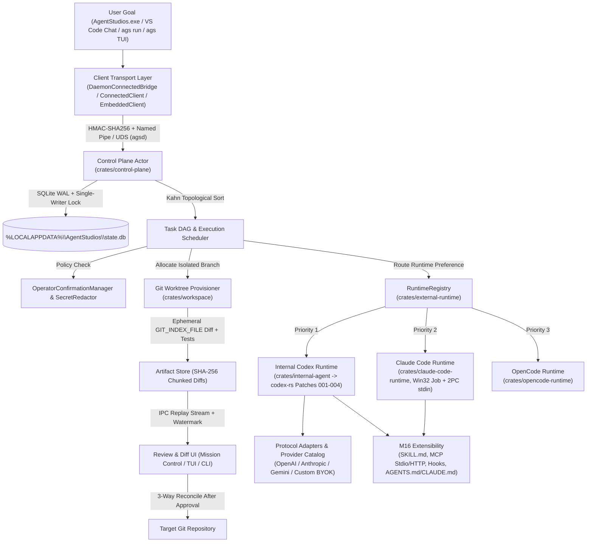
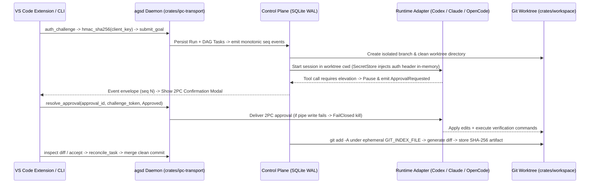

# 03 — End-to-End Architecture & Execution Flow

> **Scope**: Authoritative runtime flow from user goal submission to worktree verification, diff capture, review, and patch reconciliation (`00e5c862b8`).

---

## 1. System Execution Flow

---

## 2. Two-Phase Approval & Worktree Isolation Sequence

---

## 3. Authoritative Source Anchors

- **Daemon Entrypoint & IPC Loop**: `agent-studios-rs/crates/ipc-transport/src/bin/agsd.rs`, `server.rs`
- **Daemon & Client Auth Protocol**: `agent-studios-rs/crates/ipc-protocol/src/redaction.rs`, `approval.rs`
- **DAG & SQLite State**: `agent-studios-rs/crates/control-plane/src/`
- **Ephemeral Diff Capture & 3-Way Reconciliation**: `agent-studios-rs/crates/workspace/src/{capture.rs,reconciliation.rs,artifact_store.rs}`
- **Runtime Override Seams into Upstream Codex**: `codex-rs/core/src/{client.rs,model_runtime.rs,thread_manager.rs,agent/control.rs}`
- **Extension Entry & Mode Continuity**: `apps/agent-studios-vscode/src/{extension.ts,commands/CommandsRegistry.ts,bridge/DaemonConnectedBridge.ts}`
