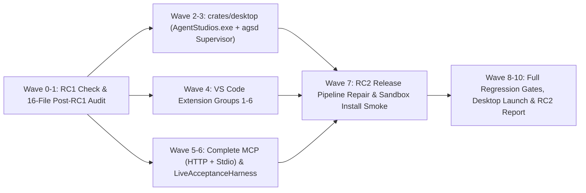

# 12 — Next-Generation Implementation Plan (`RC2` → `RC3` → `GA`)

## 1. Execution DAG (`Waves 0–10`)

## 2. Release Trajectory

- **RC2 (`v1.0.0-rc2`, Current Execution Target)**: Delivers `AgentStudios.exe` standalone launcher/supervisor, daily coding VS Code extension features (Groups 1–6), complete HTTP+Stdio MCP engine, `$0.00`-guarded `LiveAcceptanceHarness`, repaired version+SHA release packaging, and verified real sandbox install/upgrade/uninstall smoke tests.
- **RC3 (`GATE-03` Live Acceptance)**: Upon operator provision of API keys and `$1`–`$5` test budget, execute `LiveAcceptanceHarness` and `AGENT_STUDIOS_LIVE_CLI_SMOKE=1` against live Anthropic/OpenAI/Gemini models.
- **v1.0.0 GA (`GATE-04` Production Signing)**: Bundled Code-OSS Electron runtime distribution signed with production Authenticode EV/OV certificate (`makensis` `.exe` installer), auto-updater channel activation, and public release publish.
